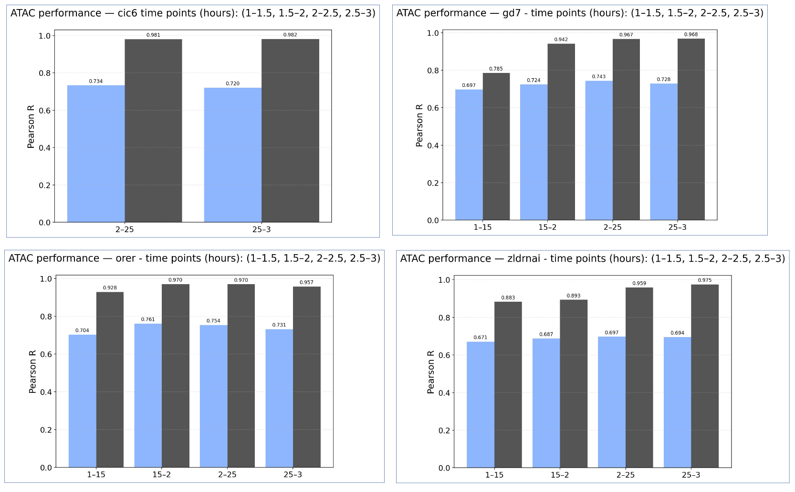

# Internship_EylulSevinc_07-25

## Overview
This repository contains documentation and code for my internship research titled "Understanding Cis-Regulatory code of chromatin accessibilty in the early *Drosophila melanogaster* development using Deep Learning"

## Contents
This repository has the following folders:

```text
scripts/
├── processing_data/      # Data preprocessing, peak merging, and window generation scripts
├── model_training/       # Scripts for model training and evaluation
├── statistical/          # Statistical analyses including q-normalization and t-tests 
├── generating_figures/   # Plotting and visualization scripts for model performance and results
└── predictions.py
```
   
## Introduction
During early *Drosophila melanogaster* embryogenesis, large-scale chromatin remodelling establishes the first gene-regulatory programs that pattern the embry along its anterior-posterior and dorsoventral axes. Chromatin accessibility, the extent which DNA is open for transcription factor (TF) binding, is a critical aspect of this regulatory code. Understanding how specific DNA motifs enable certain TFs to bind and regulate these regions is key to decoding the cis-regulatory logic of development.

Chromatin accessibility determines which enhancers are active: open regions permit TF binding, while closed regions remain repressed. During zygotic genome activation, the pioneer TF Zelda establishes a baseline of open chromatin, and patterning TFs such as Dorsal, Twist, Bicoid, and Caudal refine enhancer activity and regulate Hox genes that define embryonic segments (Brennan et al., 2023).

Recent studies have shown that DNA sequence features alone can predict chromatin accessibility and TF binding when modeled with deep learning. Methods such as BPNet and ChromBPNet learn how combinations and spatial arrangements of sequence motifs encode regulatory activity (Kopp et al., 2020; Avsec et al., 2021). Attribution approaches including DeepLIFT and Integrated Gradients then identify which motifs most strongly influence model predictions, revealing the underlying cis-regulatory code (Shrikumar et al., 2017; Gupta et al., 2022).

Applications of theese models to early *Drosophila* embryos have uncovered canonical motifs for TFs such as Zelda, Dorsal, Twist, Bicoid, and Caudal, as well as motif co-occurence patterns that predict enhancer activity (Natarajan et al. 2023; Combs et al., 2023).

Building on this framework, this project aimed to identify sequence motfis that drive chromatin accessibilty and TF binding in early *Drosophila* emryos. Using publicly available ATAC-seq and ChIP-nexus data from multiple developmental stages and TF-mutant backgrounds (Brennan et al., 2023; Natarajan et al., 2023), a convolutional multilayer perceptron (Conv-MLP) model implemented in gReLU was trained on 200-bp genomic windows to predict accessibility and binding signals. Comparing predictions between wild-type and mutant conditions at different time-points enabled the detection of regions and motifs driving changes in chromatin accessibility during early *Drosophila* embryonic development. 

## Methodology

### Data Preprocessing
The datasets used in this project were obtained from Brennan et al. (2023), which investigated transcription factor binding and chromatin accessibility during early Drosophila melanogaster embryogenesis. All raw and processed data were downloaded from the Gene Expression Omnibus (GEO) under the accession number GSE218852, aligned to the Drosophila reference genome dm6. The dataset includes ATAC-seq, ChIP-nexus, MNase-seq, and histone modification (H3K4me1, WCE) signal tracks in bigWig (bw) format, along with corresponding narrowPeak files identifying regions of significant signal enrichment.
For the ChIP-nexus experiments, signal tracks were provided separately for the positive and negative DNA strands, covering transcription factors Bicoid (Bcd), Caudal (Cad), Dorsal (Dl), GAGA factor (GAF), Twist (Twi), and Zelda (Zld) in the orer (wild-type) background at the mid-blastula transition (MBT) time point. The ATAC-seq datasets covered four developmental stages (1–1.5 h, 1.5–2 h, 2–2.5 h, and 2.5–3 h after egg laying) and multiple genetic backgrounds (orer, gd7, zldRNAi, cic6).
To construct the training data, a union set of peaks was generated from all available narrowPeak files across both ATAC-seq and ChIP datasets. Each peak region was then extended by adding overhangs on both ends and subdivided into non-overlapping 200 bp windows, ensuring that all windows remained within chromosome boundaries. These 200 bp regions served as the core genomic units for model input.
Before training, regions overlapping the ENCODE Drosophila blacklist were filtered out to remove genomic artifacts and low-quality signal regions. The resulting processed dataset contained approximately 450,000 genomic windows across all chromosomes.
Two separate gReLU convolutional multilayer perceptron (Conv-MLP) models were trained — one using ATAC-seq signals to predict chromatin accessibility, and the other using ChIP-nexus signals to model transcription factor binding profiles.

### Model Implementation

Model training and evaluation were performed using the gReLU Python package developed by Genentech ([Genentech/gReLU](https://github.com/Genentech/gReLU)). This library provides deep learning architectures tailored for regulatory genomics, including convolutional and hybrid models optimized for genomic sequence data.

Initial experiments were conducted using the predefined CNN model available in gReLU to predict chromatin accessibility (ATAC-seq) and transcription factor binding (ChIP-nexus) signals from 200 bp DNA sequence inputs. However, this baseline CNN displayed limited performance, likely due to the complex combinatorial nature of the Drosophila regulatory code.

To improve learning capacity, a Convolutional Multilayer Perceptron (ConvMLP) model was implemented and trained separately for ATAC and ChIP datasets. The ConvMLP architecture combines convolutional filters that capture local motif patterns with fully connected layers that model higher-order motif interactions. The model was trained on approximately 450,000 non-overlapping 200 bp genomic windows. Each window was represented as a one-hot–encoded DNA sequence and paired with its corresponding normalized signal intensity from the processed ATAC or ChIP bigWig files. Training and validation splits were generated by chromosome partitioning to avoid signal leakage between neighboring genomic regions.

The training objective was to minimize the mean squared error (MSE) between predicted and measured accessibility or binding signals. Early stopping with patience was applied to prevent overfitting. Model performance was assessed using Pearson correlation (R) between predicted and observed signal values on held-out test chromosomes.

In parallel, an attempt was made to adapt the Enformer model — a transformer-based architecture pre-trained on human and mouse genomes — to Drosophila data. The plan involved fine-tuning Enformer using the same ~500k genomic intervals employed for ConvMLP training. However, due to time constraints this retraining was not completed within the internship period. Nevertheless, comparing convolutional and transformer-based architectures would help highlight the complementary strengths of convolutional and transformer-based approaches for learning genome-to-signal mappings.


## Results and Discussion

### Model Performance
The trained ConvMLP models achieved robust predictive performance across multiple Drosophila developmental stages and genetic backgrounds.
Across all conditions, Pearson correlations (R) between predicted and measured ATAC-seq signals ranged from ≈0.67 to 0.76, while correlations between biological replicates themselves ranged from ≈0.88 to 0.98 (Figure 1).
This comparison establishes an empirical upper limit for achievable model accuracy: since replicate measurements are not perfectly correlated, any model can only capture the reproducible portion of the biological signal.
The ConvMLP models therefore account for a substantial fraction of the explainable variance—typically 70–80% of the correlation observed between replicates—indicating strong sequence-to-signal learning despite experimental noise.
Performance patterns were consistent across genotypes, with slightly higher correlations observed for wild-type (orer) and Zelda-depleted (zldRNAi) embryos than for gd7 and cic6 mutants.
Across all four backgrounds, performance remained stable across time points (1–3 h after egg laying), confirming that the model generalizes well to dynamic developmental contexts.




### Quantile Normalization and Statistical Analysis
Following model training, predicted and measured signal matrices were quantile-normalized to ensure comparability across replicates and experimental conditions.
To identify genomic regions showing significant changes in chromatin accessibility or transcription factor binding, Benjamini–Hochberg–corrected t-tests were performed between wild-type (orer) and each mutant condition, as well as across developmental time points.
The analysis was conducted in two stages:
first, ATAC-seq t-tests were used to detect regions with significant accessibility changes (q < 0.01);
then, ChIP-nexus t-tests were applied to those ATAC-significant regions, and sites with q < 0.05 in ChIP were retained as final significant regions.
This approach prioritized regions that showed both altered chromatin accessibility and transcription factor binding. These significantly changing regions provide high-confidence candidates for subsequent motif attribution and interpretation.

### Model Interpretation with Integrated Gradients
To identify which sequence motifs most strongly influenced model predictions and identifiy key regulatory motifs for *Drosophila melanogaster* development, Integrated Gradients (IG) attribution analysis was applied using the [Captum AI library](https://captum.ai/docs/extension/integrated_gradients). For each 200 bp genomic window, IG computed a base-pair–level contribution score reflecting how changes in nucleotide identity would alter the model’s predicted accessibility or TF-binding signal.
These attribution maps highlight the sequence positions that most strongly influence the model’s predictions, enabling the visualization of transcription factor motifs that drive accessibility or binding.
While a full motif discovery analysis could not be completed within the internship period, these IG-based attributions form the foundation for downstream motif clustering and comparison with known Zelda, Dorsal, Twist, and Caudal binding motifs described in prior studies (Brennan et al., 2023).

## Quick Start
#### 1. Clone the repository
#### 2. Navigate to the project directory:
#### 3. Create a virtual environment: 
#### 4. Install required packages
#### 5. Running the pipeline

## References

[1] Brennan, K. J., Weilert, M., Krueger, S., Pampari, A., Liu, H., Yang, A. W., Morrison, J. A., Hughes, T. R., Rushlow, C. A., Kundaje, A., & Zeitlinger, J. (2023). Chromatin accessibility in the Drosophila embryo is determined by transcription factor pioneering and enhancer activation. Developmental Cell, 60. https://doi.org/10.1016/j.devcel.2023.XX.XXX

[2] Cardamone, F., Piva, A., Löser, E., Eichenberger, B., Romero-Mulero, M. C., Zenk, F., Shields, E. J., Cabezas-Wallscheid, N., Bonasio, R., Tiana, G., Zhan, Y., & Iovino, N. (2025, March 27). Chromatin landscape at cis-regulatory elements orchestrates cell fate decisions in early embryogenesis. Nature News. https://www.nature.com/articles/s41467-025-57719-4 

[3] Calderon, D., Blecher-Gonen, R., Huang, X., Secchia, S., Kentro, J., Daza, R. M., Martin, B., Dulja, A., Schaub, C., Trapnell, C., Larschan, E., O’Connor-Giles, K. M., Furlong, E. E. M., & Shendure, J. (2022). The continuum of Drosophila embryonic development at single-cell resolution. Science, 377(6606), eabn5800. https://doi.org/10.1126/science.abn5800

[4] de Almeida, B. P., Schaub, C., Pagani, M., Secchia, S., Furlong, E. E. M., & Stark, A. (2023). Targeted design of synthetic enhancers for selected tissues in the Drosophila embryo. Nature, 626, 207-211. https://doi.org/10.1038/s41586-023-06905-9

[5] Secchia, S., Forneris, M., Heinen, T., Stegle, O., & Furlong, E. E. M. (2022). Simultaneous cellular and molecular phenotyping of embryonic mutants using single-cell regulatory trajectories. Developmental Cell, 57(4), 496-511.e1-e8. https://doi.org/10.1016/j.devcel.2022.01.016

[6] Wang, M., Hu, Q., Tu, Z., Kong, L., Yao, J., Xiang, R., Chen, Z., Zhao, Y., Zhou, Y., Yu, T., Wang, Y., Jia, Z., Ouyang, K., Wang, X., Bai, Y., Lian, M., Yang, Z., Yang, T., Chen, J., Huang, Y., Yin, N., Mo, W., Liang, W., Liu, C., Lin, X., Liu, C., Gu, Y., Hu, Y. (2024). A single-cell 3D spatiotemporal multi-omics atlas from Drosophila embryogenesis to metamorphosis. bioRxiv. https://doi.org/10.1101/2024.02.06.577903